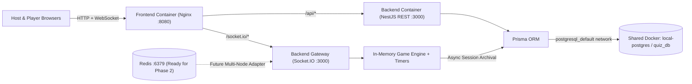

# GlassQuiz — Architecture & Production-Testing Proposal

## 1. Overview
**GlassQuiz** is a real-time interactive quiz and audience polling platform inspired by Kahoot and Slido, built with a Glassmorphic dark UI using **Vue 3**, **Pinia**, **Tailwind CSS**, **NestJS**, **Socket.IO**, and **PostgreSQL**.

This proposal documents the production-testing architecture, core capabilities implemented, and boundaries between the current release and future scaling phases.

---

## 2. Goals for Production Testing
1. **Zero-Friction Live Gameplay**: Hosts launch public quizzes with a 6-digit PIN and shareable `/play?pin=XXXXXX` links; players join from phones/browsers with nicknames and no sign-up required.
2. **Cheating & Timing Integrity**:
   - Public API endpoints never expose `isCorrect` answer flags.
   - Question countdowns are enforced by an authoritative server-side timer.
   - Late answers past the deadline and duplicate submissions are rejected.
3. **Resilient Real-Time Sessions**:
   - Host and player reconnect tokens (`sessionStorage`) survive page refreshes and transient mobile network drops.
   - Disconnecting players do not stall active questions; host departures cleanly notify participants.
4. **Shared Docker Database Compatibility**:
   - Shares the existing `local-postgres` Docker PostgreSQL server (`quiz_db` database) without port collisions.
5. **Single-Command Production Testing**:
   - Multi-stage Dockerfiles + Nginx reverse proxy (`/api/` and `/socket.io/`) + `/health` probe.

---

## 3. System Architecture

---

## 4. Scope Breakdown

### Included in Production-Testing Release
- **Host Authentication (`AuthModule`)**: Email/password registration and login using `scrypt` password hashing and HS256 JWT tokens.
- **Quiz Library & Builder**:
  - Public quiz browsing without answer leakage (`GET /quizzes`, `GET /quizzes/:id`).
  - Authenticated Create, Edit, and Delete (`POST /quizzes`, `PUT /quizzes/:id`, `DELETE /quizzes/:id`, `GET /quizzes/:id/manage`).
  - Multiple Choice (2–6 options, single or multiple correct answers) and True/False questions, configurable time limits (5–300s), points (100–10,000), and optional image URLs.
- **Live Game Engine**:
  - 6-digit PIN lobby, copyable invite links (`/play?pin=XXXXXX`), live answer counter, early question ending, speed + streak scoring formula, Top 5 leaderboard, and Top 3 podium with confetti.
  - PostgreSQL archival of `Room`, `Participant`, and `ParticipantAnswer` records.
- **Operational Readiness**:
  - Strict TypeScript compilation, automated unit tests, `/health` endpoint, CORS allowlist, security headers, and rate-limited WebSocket joins/creates.

### Deferred to Future Phases
- Multi-instance horizontal Socket.IO scaling using `@socket.io/redis-adapter` + Redis Sorted Sets.
- Self-paced asynchronous exam mode (Moodle-style).
- Sound effects and binary file/image uploads to object storage.
- Automated Playwright browser E2E suite.
