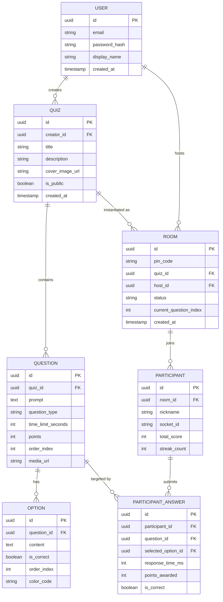
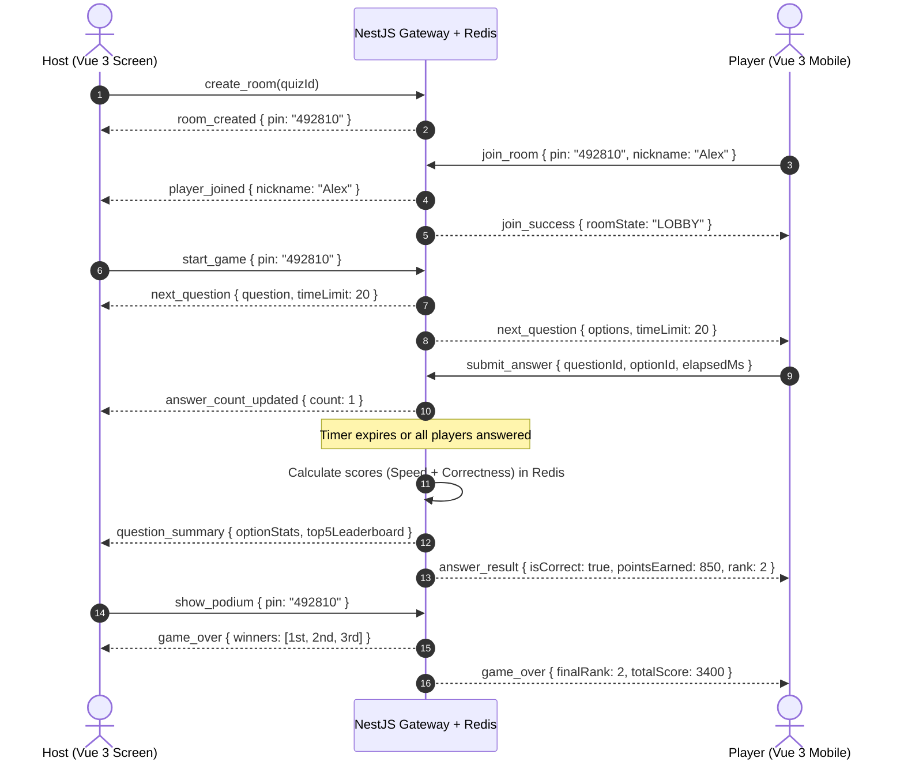

# Custom Quiz Application: Research, Architecture & Implementation Plan

This document provides a complete deep-dive study of modern quiz platforms (Kahoot, Slido, Moodle Quiz) and outlines an architectural blueprint and roadmap to build a custom quiz platform using **Vue 3**, **NestJS**, and **PostgreSQL** with a modern **Glassmorphic (glassy)** user interface.

---

## 1. Deep Research: Comparing Existing Quiz Platforms

| Feature / Aspect | **Kahoot!** | **Slido** | **Moodle Quiz** |
| :--- | :--- | :--- | :--- |
| **Primary Focus** | Gamification, classroom excitement, fast engagement | Live audience polling, Q&A, corporate meetings | Academic assessment, grading, certification |
| **Interaction Mode** | Synchronous (live, shared screen host + mobile remotes) | Synchronous live polls + asynchronous Q&A | Asynchronous (self-paced with start/end deadlines) |
| **Scoring Model** | Speed + accuracy bonus (points decay over time) | Accuracy or single-choice poll stats | Configurable grading, partial credit, negative points |
| **Question Display** | Questions on host projector; players tap color/shape buttons | Question + options displayed directly on participant phone | Full exam paper layout on individual screen |
| **Real-time Need** | Extremely high (sub-second sync, audio, countdowns) | Medium-High (instant bar chart/word cloud updates) | Low (form auto-save every 30–60 seconds) |
| **Question Types** | Multiple Choice, True/False, Puzzle | Poll, Word Cloud, Rating, Open Text, Quiz | 15+ types: Cloze, Matching, Essay, Calculated, etc. |
| **Strengths** | Fun music, high adrenaline, high dopamine | Professional, frictionless (no account needed for guests) | Strict academic integrity, question banks, shuffle options |
| **Weaknesses** | Not suitable for serious exams; questions hidden on phones | Limited gamification / sound effects | Outdated UI; complex configuration |

### What You Should Build: The Hybrid Model
For your custom application, the most powerful and enjoyable architecture is a **Hybrid Platform**:
1. **Live Game Mode (Kahoot/Slido style)**: Host launches a room with a 6-digit PIN. Players join on their phones with nicknames (no sign-up required for players). Host controls the game flow with real-time timers and instant leaderboards.
2. **Self-Paced Mode (Moodle style)**: Host generates a direct link. Students take the quiz individually at any time, with randomized questions and instant grading on submit.

---

## 2. Recommended Tech Stack

```mermaid
flowchart TD
    subgraph Frontend ["Frontend (Client)"]
        Vue["Vue 3 (Composition API + TypeScript)"]
        Pinia["Pinia (State Management)"]
        Tailwind["Tailwind CSS (Glassmorphism & Gradients)"]
        SocketClient["Socket.io-client"]
    end

    subgraph Backend ["Backend (Server)"]
        Nest["NestJS (TypeScript Framework)"]
        Gateway["NestJS WebSocket Gateway (Socket.io)"]
        Prisma["Prisma ORM / TypeORM"]
    end

    subgraph DataStore ["Data & Cache Layer"]
        Postgres[(PostgreSQL - Persistent Data)]
        Redis[(Redis - Live Room & Leaderboard Cache)]
    end

    Vue -->|REST API (HTTP/JSON)| Nest
    SocketClient <-->|Bidirectional WebSockets| Gateway
    Nest -->|Queries & Migrations| Prisma
    Prisma --> Postgres
    Gateway <-->|Fast In-Memory State & Sorted Sets| Redis
```

### Why this stack fits your project:
1. **Frontend (Vue 3 + Pinia + Tailwind CSS)**:
   - **Vue 3 `<script setup lang="ts">`**: Reactive, fast, and clean.
   - **Tailwind CSS**: Ideal for crafting glassmorphic styling (backdrop filters, alpha opacity colors, soft glows).
   - **Canvas-Confetti**: Lightweight library for podium victory animations.
2. **Backend (NestJS)**:
   - Built-in TypeScript support with clean modular architecture (`AuthModule`, `QuizzesModule`, `GameRoomsModule`).
   - First-class WebSocket Gateway support (`@nestjs/websockets`) using `Socket.io` with room broadcasting.
3. **Database (PostgreSQL)**:
   - Strong relational integrity for Users, Quizzes, Questions, and Options.
   - Native `JSONB` support for flexible question configurations (e.g. timer limits, image URLs, point multipliers).
4. **Cache & Live State (Redis - Recommended Addition)**:
   - *Why Redis?* During a live game with 50+ participants clicking answers simultaneously, writing every tick to PostgreSQL will choke the database.
   - Redis keeps transient game room state in RAM and calculates real-time leaderboards in milliseconds using **Redis Sorted Sets (`ZADD`, `ZREVRANGE`)**.
   - When the game finishes, final results are archived into PostgreSQL.

---

## 3. Database Schema Design (PostgreSQL)



---

## 4. Real-Time Live Quiz Workflow (WebSocket Protocol)

The WebSocket gateway coordinates the live game state between the **Host Screen** (projector/desktop) and **Player Screens** (phones/tablets).



### Dynamic Scoring Formula (Kahoot-style):
$$\text{Points} = \begin{cases} 
\text{Round}\left(1000 \times \left(1 - \frac{\text{response\_time\_ms}}{2 \times \text{time\_limit\_ms}}\right)\right) & \text{if correct} \\
0 & \text{if incorrect}
\end{cases}$$
- A player who answers correctly in 1 second on a 20-second question receives $\approx 975$ points.
- A player who answers right before the 20-second timer runs out still receives 500 points.
- This creates excitement and rewards both speed and knowledge.

---

## 5. Modern Glassmorphic ("Glassy") UI Design System

Glassmorphism relies on translucency, multi-layered depth, vivid background lighting, and frosted glass backdrops.

### Why Glassmorphism Works:
1. **Background Contrast**: Frosted glass only looks glassy if there is vivid, colorful contrast underneath it (such as dynamic mesh gradients, dark indigo or purple aurora glows).
2. **Backdrop Filter**: `backdrop-blur-md` or `backdrop-blur-xl` blurs everything behind the container.
3. **Subtle Light Borders**: A 1px translucent border (`border border-white/20`) mimics the edge of reflective glass.
4. **Soft Glow & Shadows**: Subtle outer drop shadows and soft inner glows give tactile depth.

### Design Tokens for Tailwind CSS

```css
/* Glass Surface Utilities */
.glass-panel {
  background: rgba(255, 255, 255, 0.07);
  backdrop-filter: blur(16px);
  -webkit-backdrop-filter: blur(16px);
  border: 1px solid rgba(255, 255, 255, 0.15);
  box-shadow: 0 8px 32px 0 rgba(0, 0, 0, 0.37);
  border-radius: 1rem;
}

.glass-card-interactive {
  background: rgba(255, 255, 255, 0.1);
  backdrop-filter: blur(12px);
  border: 1px solid rgba(255, 255, 255, 0.2);
  transition: all 0.2s cubic-bezier(0.4, 0, 0.2, 1);
}
.glass-card-interactive:hover {
  background: rgba(255, 255, 255, 0.18);
  border-color: rgba(255, 255, 255, 0.4);
  transform: translateY(-2px);
  box-shadow: 0 12px 24px -6px rgba(0, 0, 0, 0.4);
}

.glass-input {
  background: rgba(255, 255, 255, 0.05);
  backdrop-filter: blur(8px);
  border: 1px solid rgba(255, 255, 255, 0.2);
  color: #ffffff;
}
.glass-input:focus {
  border-color: rgba(168, 85, 247, 0.8); /* Purple accent */
  outline: none;
  box-shadow: 0 0 15px rgba(168, 85, 247, 0.4);
}
```

### Color Palette for Quiz Option Tiles
Give each answer option a distinct glassy tint that pops on screen:
- **Option A (Red / Rose)**: `bg-rose-500/20 border-rose-400/40 hover:bg-rose-500/35 text-rose-100`
- **Option B (Blue / Cyan)**: `bg-sky-500/20 border-sky-400/40 hover:bg-sky-500/35 text-sky-100`
- **Option C (Yellow / Amber)**: `bg-amber-500/20 border-amber-400/40 hover:bg-amber-500/35 text-amber-100`
- **Option D (Green / Emerald)**: `bg-emerald-500/20 border-emerald-400/40 hover:bg-emerald-500/35 text-emerald-100`

---

## 6. Project Directory Structure

```text
quiz-project/
├── backend/                  # NestJS API & WebSocket Server
│   ├── src/
│   │   ├── auth/             # JWT Auth & Guard (Host Login)
│   │   ├── quizzes/          # Quiz CRUD & Question Bank
│   │   ├── game/             # Game Rooms, Socket Gateway & Events
│   │   │   ├── game.gateway.ts
│   │   │   ├── game.service.ts
│   │   │   └── dto/
│   │   ├── prisma/           # Database Schema & Client
│   │   │   └── schema.prisma
│   │   └── app.module.ts
│   ├── package.json
│   └── tsconfig.json
│
├── frontend/                 # Vue 3 Single Page Application
│   ├── src/
│   │   ├── assets/           # Background gradients & sound effects
│   │   ├── components/
│   │   │   ├── ui/           # GlassButton, GlassCard, GlassInput
│   │   │   ├── host/         # HostLobby, HostQuestionView, HostPodium
│   │   │   ├── player/       # PlayerPinEntry, PlayerAnswerPads, PlayerScoreCard
│   │   │   └── editor/       # QuizBuilder, QuestionForm
│   │   ├── stores/           # Pinia stores (auth.ts, game.ts, quiz.ts)
│   │   ├── views/            # HomeView, HostView, PlayView, DashboardView
│   │   ├── router/
│   │   └── App.vue
│   ├── tailwind.config.js
│   ├── package.json
│   └── vite.config.ts
```

---

## 7. Step-by-Step Implementation Roadmap

### Phase 1: Foundation & Data Modeling
1. Initialize the monorepo or dual-folder structure (`backend/` and `frontend/`).
2. Setup PostgreSQL database and initialize Prisma in NestJS (`npx prisma init`).
3. Define models (`User`, `Quiz`, `Question`, `Option`, `Room`, `ParticipantAnswer`) and run migrations.
4. Build standard REST endpoints for Quiz CRUD (create, read, update, delete quizzes and questions).

### Phase 2: Glassmorphic UI & Quiz Creator
1. Initialize Vue 3 with Vite, TypeScript, and Tailwind CSS.
2. Build the reusable Glassmorphism UI library (`GlassCard`, `GlassButton`, `GlassInput`).
3. Implement the **Quiz Creator Dashboard**:
   - Add/remove questions.
   - Set question time limits (10s, 20s, 30s) and points.
   - Upload question media/images.
   - Toggle correct options.

### Phase 3: Real-Time Engine (NestJS WebSockets + Redis)
1. Configure NestJS WebSocket Gateway with `socket.io`.
2. Implement Room Management:
   - Generate unique 6-digit PIN.
   - Handle player connection, nickname validation, and player lobby list.
3. Implement Game State Machine:
   - `LOBBY` $\rightarrow$ `QUESTION_START` $\rightarrow$ `QUESTION_ACTIVE` (countdown timer) $\rightarrow$ `QUESTION_RESULTS` $\rightarrow$ `LEADERBOARD` $\rightarrow$ `PODIUM`.
4. Calculate scores in real time based on response timestamp and correctness.

### Phase 4: Polish, Sound & Animations
1. Integrate sound effects (countdown ticking, correct/wrong sound, celebratory podium fanfare).
2. Add `canvas-confetti` fireworks for top 3 winners on the host screen.
3. Optimize mobile layout so player controls feel native, responsive, and responsive to touch taps.

### Phase 5: Self-Paced (Moodle) Mode (Optional Expansion)
1. Add student exam view: take quiz with timer running locally, submit all answers at once, get score report.
